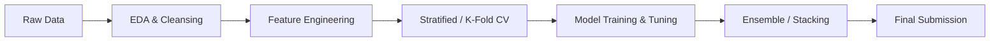

# 📊 Datavidia - Arkavidia | Data Science Competition

Repository ini berisi kode sumber, analisis data, eksperimen pemodelan *Machine Learning*, dan dokumentasi tim untuk kompetisi **Datavidia** pada rangkaian acara **Arkavidia** yang diselenggarakan oleh Himpunan Mahasiswa Informatika (HMIF) Institut Teknologi Bandung (ITB).

---

## 👥 Profil Tim

| No | Nama | Peran / Fokus | GitHub / Kontak |
|---|---|---|---|
| 1 | **Pitri Wulandari** | Data Preprocessing & Modeling | [@Pitriwulandari](https://github.com/Pitriwulandari) |
| 2 | **Farhat** | Exploratory Data Analysis (EDA) & Feature Engineering | - |
| 3 | **Habib Abdul Ghani** | End-to-End ML Pipeline, Feature Engineering, Multi-Model Ensemble, Validation Audit & Zero-Retraining Packaging (Task-1 & Task-2) | [@Kaga-nim](https://github.com/Kaga-nim) |

*(Catatan: Anda dapat menyesuaikan peran spesifik masing-masing anggota di atas sesuai pembagian tugas tim.)*

---

## 📌 Tentang Kompetisi & Task-1

**Datavidia** merupakan salah satu cabang kompetisi analitik data dan *data science* nasional dalam rangkaian acara **Arkavidia**.

### 🎯 Objektif Task-1 (Status Penanganan Paket)
- **Tantangan:** Memprediksi status akhir penanganan paket pengiriman (**lancar**, **telat**, **rusak**, atau **retur**) sedini mungkin dari data awal.
- **Tujuan Bisnis:** Mengidentifikasi potensi anomali/kegagalan pengiriman secara preventif sebelum kendala terjadi di lapangan.
- **Tipe Tugas:** *Multi-class Classification*.
- **Detail & Tautan:** Lihat [TASK-1.md](docs/TASK-1.md).

---

## 📂 Struktur Direktori

```text
datavidia/
├── docs/                           # Dokumentasi & catatan kompetisi
│   ├── TASK-1.md                   # Ringkasan & tautan Task-1
│   ├── TASK-2.md                   # Ringkasan, aturan & spesifikasi Task-2 (World Phenomena)
│   └── INFO-KOMPETISI.md           # Overview, data, leaderboard, aturan lengkap Task-1
├── pitri/                          # Workspace pribadi Pitri
│   ├── notebooks/
│   └── results/
├── farhat/                         # Workspace pribadi Farhat
│   └── notebooks/
├── ghani/                          # Workspace pribadi Ghani (simetris per task & per versi)
│   ├── task1/                      # src/, models/, cache/, notebooks/, results/LOG.md (v1..v8)
│   ├── task2/                      # src/, models/, cache/, notebooks/, results/LOG.md (v1..)
│   ├── submissions/                # task1/ & task2/ (file CSV submission pribadi Ghani - di-ignore git)
│   └── README.md
├── data/archive/                   # Zip asli dari Kaggle (di-ignore git)
├── Task-1-Datavidia-11.0/          # Data hasil ekstrak Task-1 - di-ignore git
├── Task-2-Datavidia-11.0/          # Data hasil ekstrak Task-2 - di-ignore git
├── requirements.txt
├── .gitignore
└── README.md
```

> **Catatan:** `Task-1-Datavidia-11.0/` masih di root karena path-nya dipakai skrip di `ghani/src/`. Setelah pipeline stabil, bisa dipindah ke `data/raw/` dengan mengubah `ROOT` di `ghani/src/baseline_lgbm.py`.

**Penamaan submission:** `{nama}/submissions/task{1|2}/submission_v{n}_{nama}.csv` (contoh: `ghani/submissions/task2/submission_v1_ghani.csv`). Nomor n = urutan eksperimen orang tersebut, dicatat di `{nama}/results/LOG.md`.

**Aturan kerja:** eksperimen pribadi di folder masing-masing; notebook final untuk dikumpulkan ke panitia disiapkan dari folder anggota yang skornya terbaik. Dataset, model, dan submission tidak di-commit.

---

## 🛠️ Tech Stack & Alat

- **Bahasa Pemrograman:** Python 3.9+
- **Data Manipulation & Analysis:** `pandas`, `numpy`
- **Visualisasi Data:** `matplotlib`, `seaborn`
- **Machine Learning & Deep Learning:** `scikit-learn`, `xgboost`, `lightgbm`, `catboost`, `PyTorch`, `torchvision`, `OpenCV`, `igraph`
- **Eksperimen & Notebook:** Jupyter Notebook / Google Colab / VS Code

---

## 🚀 Alur Kerja & Metodologi



1. **Exploratory Data Analysis (EDA):** Mengidentifikasi distribusi target, *missing values*, *outliers*, dan interaksi antar variabel.
2. **Data Preprocessing:** Imputasi nilai kosong, *encoding* data kategorikal, normalisasi/standardisasi fitur numerik, serta penanganan *imbalanced data*.
3. **Feature Engineering:** Pembentukan fitur agregasi, interaksi fitur, ekstraksi tanggal/teks (jika relevan), dan seleksi fitur penting.
4. **Validation Strategy:** Menggunakan *K-Fold Cross Validation* (misal: 5-Fold Stratified CV) untuk mencegah *data leakage* dan *overfitting*.
5. **Model Exploration & Blending:** Eksperimen algoritma berbasis *tree-based models* (LightGBM, XGBoost, CatBoost) serta teknik *blending/weighted ensemble* untuk memaksimalkan performa pada metrik evaluasi kompetisi.

---

## 💻 Panduan Instalasi & Penggunaan

### 1. Kloning Repository
```bash
git clone https://github.com/Pitriwulandari/Datavidia.git
cd Datavidia
```

### 2. Buat Lingkungan Virtual (Virtual Environment)
```bash
# Windows (PowerShell)
python -m venv venv
.\venv\Scripts\Activate.ps1

# Linux / macOS
python3 -m venv venv
source venv/bin/activate
```

### 3. Instalasi Dependensi
```bash
pip install -r requirements.txt
```

### 4. Menjalankan Notebook
```bash
jupyter notebook ghani/notebooks/
```

---

## 📈 Eksperimen & Riwayat Skor

### Task-1: Status Penanganan Paket
| Model ID | Pendekatan / Fitur | CV Macro F1 | Leaderboard Public | Leaderboard Private | Keterangan |
|---|---|---|---|---|---|
| `v1` | Baseline LightGBM + agregasi dasar 9 tabel | `0.4941` | `0.47761` | - | Benchmark awal |
| `v2` | LightGBM + OOF Target Encoding (Farhat) / sekuensial | `0.57514` | `0.56426` | - | Lompatan Target Encoding dasar |
| `v3` | LightGBM + OOF Target Encoding (sub 450rb) | `0.5732` | - | - | Lompatan sinyal entitas |
| `v4` | LightGBM + OOF Target Encoding (full 1,05jt) | `0.5785` | - | - | Skala penuh |
| `v5` | Feature Eng v5 + Stage-1 LGB + Joint GLMM | `0.61911` | - | - | 5-Fold Stratified CV |
| `v6` | Stage-2 Super-Ensemble 6 model + Joint GLMM | `0.62561` | `0.60163` | - | Ensemble penuh sebelum pembersihan polusi test |
| `v7` | Pure Within-Split (`cu_sp_*`) tanpa memori `train` | `0.62949` | `0.48847` | - | Bukti empiris bahwa sinyal customer berasal dari `train` |
| **`v8`** | **Pure Train-Only `cu_tr_*` + Scale-Normalized GLMM + 6-Family Super-Ensemble** | **`0.62912`** | **`0.60757`** (#16 / 213) | *(menunggu rilis)* | **Submission final terpilih (0% polusi test, 0% scale shift)** |

### Task-2: World Phenomena *(Berjalan)*
| Versi | Anggota | Pendekatan / Fitur | Leaderboard Public | Keterangan |
|---|---|---|---|---|
| `v1` | Ghani | Pure-Vision Physical Spectral Change Signatures | `0.11158` | Baseline awal fitur perubahan fisik |
| `v1` | Farhat | DINOv2 ViT-S/14 (`timm`) + K-Means (`k=6`) + Probe + Sinkhorn | `0.14510` | Eksperimen awal Farhat |
| **`v3`** | **Ghani** | **Cloud-Adaptive Multi-Backbone Event-Graph + 5-Fold 3-Family Ensemble** | **`0.37895`** (#26) | **De-augmentasi rotasi/grayscale/tint/awan + Louvain + MLP/LR/kNN** |

---

## 📄 Lisensi & Ucapan Terima Kasih

Proyek ini dikembangkan khusus untuk perlombaan **Datavidia - Arkavidia**.
Terima kasih kepada panitia penyelenggara **HMIF ITB** dan seluruh pihak yang mendukung tim kami.
