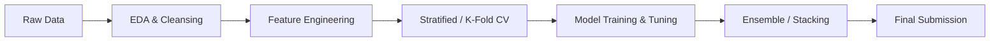

# 📊 Datavidia - Arkavidia | Data Science Competition

Repository ini berisi kode sumber, analisis data, eksperimen pemodelan *Machine Learning*, dan dokumentasi tim untuk kompetisi **Datavidia** pada rangkaian acara **Arkavidia** yang diselenggarakan oleh Himpunan Mahasiswa Informatika (HMIF) Institut Teknologi Bandung (ITB).

---

## 👥 Profil Tim

| No | Nama | Peran / Fokus | GitHub / Kontak |
|---|---|---|---|
| 1 | **Pitri Wulandari** | Data Preprocessing & Modeling | [@Pitriwulandari](https://github.com/Pitriwulandari) |
| 2 | **Farhat** | Exploratory Data Analysis (EDA) & Feature Engineering | - |
| 3 | **Ghani** | Model Evaluation, Hyperparameter Tuning & Pipeline | - |

*(Catatan: Anda dapat menyesuaikan peran spesifik masing-masing anggota di atas sesuai pembagian tugas tim.)*

---

## 📌 Tentang Kompetisi

**Datavidia** merupakan salah satu cabang kompetisi analitik data dan *data science* nasional dalam rangkaian acara **Arkavidia**. Kompetisi ini menantang peserta untuk menyelesaikan permasalahan berbasis data dunia nyata (*real-world problem*) melalui tahapan:
1. **Eksplorasi Data (EDA)** untuk menemukan pola, anomali, dan korelasi penting.
2. **Rekayasa Fitur (Feature Engineering)** untuk mengekstrak sinyal prediktif terbaik.
3. **Pemodelan Prediktif (Machine Learning / Deep Learning)** dengan strategi validasi yang ketat.
4. **Penyusunan Solusi & Wawasan Bisnis** yang komprehensif dan dapat dipertanggungjawabkan.

---

## 📂 Struktur Direktori

```text
datavidia/
├── data/
│   ├── raw/                # Dataset mentah dari panitia kompetisi
│   ├── processed/          # Dataset hasil pembersihan & rekayasa fitur
│   └── external/           # Data eksternal pendukung (jika diperbolehkan)
├── notebooks/
│   ├── 01_eda.ipynb                     # Analisis eksplorasi data & visualisasi
│   ├── 02_preprocessing_features.ipynb  # Pembersihan data & feature engineering
│   ├── 03_baseline_model.ipynb          # Model baseline & cross-validation setup
│   └── 04_advanced_modeling.ipynb       # Tuning, ensemble/stacking model
├── src/
│   ├── __init__.py
│   ├── data_loader.py      # Script pemuatan dan sanitasi data
│   ├── features.py         # Fungsi transformasi & ekstraksi fitur
│   ├── models.py           # Arsitektur & pelatihan model
│   └── utils.py            # Metrik evaluasi & fungsi pembantu (helper)
├── submissions/            # Berkas hasil prediksi (submission.csv)
├── requirements.txt        # Daftar dependensi & library Python
└── README.md               # Dokumentasi proyek
```

---

## 🛠️ Tech Stack & Alat

- **Bahasa Pemrograman:** Python 3.9+
- **Data Manipulation & Analysis:** `pandas`, `numpy`
- **Visualisasi Data:** `matplotlib`, `seaborn`
- **Machine Learning:** `scikit-learn`, `xgboost`, `lightgbm`, `catboost`
- **Eksperimen & Notebook:** Jupyter Notebook / Google Colab / VS Code

---

## 🚀 Alur Kerja & Metodologi



1. **Exploratory Data Analysis (EDA):** Mengidentifikasi distribusi target, *missing values*, *outliers*, dan interaksi antar variabel.
2. **Data Preprocessing:** Imputasi nilai kosong, *encoding* data kategorikal, normalisasi/standardisasi fitur numerik, serta penanganan *imbalanced data*.
3. **Feature Engineering:** Pembentukan fitur agregasi, interaksi fitur, ekstraksi tanggal/teks (jika relevan), dan seleksi fitur penting.
4. **Validation Strategy:** Menggunakan *K-Fold Cross Validation* (misal: 5-Fold Stratified CV) untuk mencegah *data leakage* dan *overfitting*.
5. **Model Exploration & Blending:** Eksperimen algoritma berbasis *tree-based models* (LightGBM, XGBoost, CatBoost) serta teknik *blending/weighted ensemble* untuk memaksimalkan performa pada metrik evaluasi kompetisi.

---

## 💻 Panduan Instalasi & Penggunaan

### 1. Kloning Repository
```bash
git clone https://github.com/Pitriwulandari/Datavidia.git
cd Datavidia
```

### 2. Buat Lingkungan Virtual (Virtual Environment)
```bash
# Windows (PowerShell)
python -m venv venv
.\venv\Scripts\Activate.ps1

# Linux / macOS
python3 -m venv venv
source venv/bin/activate
```

### 3. Instalasi Dependensi
```bash
pip install -r requirements.txt
```

### 4. Menjalankan Notebook
```bash
jupyter notebook notebooks/
```

---

## 📈 Eksperimen & Riwayat Skor

| Model ID | Pendekatan / Fitur | CV Score | Leaderboard Public | Leaderboard Private | Keterangan |
|---|---|---|---|---|---|
| `v1.0` | Baseline Model (Logistic Reg / Random Forest) | - | - | - | Benchmark awal |
| `v2.0` | LightGBM + Basic Preprocessing | - | - | - | Peningkatan akurasi/F1 |
| `v3.0` | XGBoost + CatBoost + Feature Engineering | - | - | - | Optimasi fitur |
| `v4.0` | Ensemble / Stacking Final | - | - | - | Prediksi final terpilih |

---

## 📄 Lisensi & Ucapan Terima Kasih

Proyek ini dikembangkan khusus untuk perlombaan **Datavidia - Arkavidia**.
Terima kasih kepada panitia penyelenggara **HMIF ITB** dan seluruh pihak yang mendukung tim kami.
