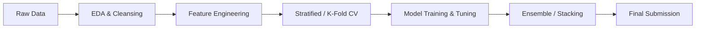

# 📊 Datavidia - Arkavidia | Data Science Competition

Repository ini berisi kode sumber, analisis data, eksperimen pemodelan *Machine Learning*, dan dokumentasi tim untuk kompetisi **Datavidia** pada rangkaian acara **Arkavidia** yang diselenggarakan oleh Himpunan Mahasiswa Informatika (HMIF) Institut Teknologi Bandung (ITB).

---

## 👥 Profil Tim

| No | Nama | Peran / Fokus | GitHub / Kontak |
|---|---|---|---|
| 1 | **Pitri Wulandari** | Data Preprocessing & Modeling | [@Pitriwulandari](https://github.com/Pitriwulandari) |
| 2 | **Farhat** | Exploratory Data Analysis (EDA) & Feature Engineering | - |
| 3 | **Ghani** | Model Evaluation, Hyperparameter Tuning & Pipeline | - |

*(Catatan: Anda dapat menyesuaikan peran spesifik masing-masing anggota di atas sesuai pembagian tugas tim.)*

---

## 📌 Tentang Kompetisi & Task-1

**Datavidia** merupakan salah satu cabang kompetisi analitik data dan *data science* nasional dalam rangkaian acara **Arkavidia**.

### 🎯 Objektif Task-1 (Status Penanganan Paket)
- **Tantangan:** Memprediksi status akhir penanganan paket pengiriman (**lancar**, **telat**, **rusak**, atau **retur**) sedini mungkin dari data awal.
- **Tujuan Bisnis:** Mengidentifikasi potensi anomali/kegagalan pengiriman secara preventif sebelum kendala terjadi di lapangan.
- **Tipe Tugas:** *Multi-class Classification*.
- **Detail & Tautan:** Lihat [TASK-1.md](docs/TASK-1.md).

---

## 📂 Struktur Direktori

```text
datavidia/
├── docs/                           # Dokumentasi & catatan kompetisi
│   ├── TASK-1.md                   # Pengumuman, link Kaggle, kontak panitia
│   └── INFO-KOMPETISI.md           # Overview, data, leaderboard, aturan lengkap
├── pitri/                          # Workspace pribadi (eksperimen, tidak masuk pipeline utama)
│   ├── notebooks/
│   └── results/                    # Screenshot / hasil evaluasi
├── farhat/                         # Workspace pribadi
│   └── notebooks/
├── ghani/                          # Workspace pribadi
│   ├── notebooks/
│   └── results/
├── notebooks/                      # Notebook bersama / final (dikumpulkan ke panitia)
├── src/                            # Kode bersama (pipeline yang dipakai tim)
│   └── baseline_lgbm.py            # Baseline: agregasi 9 tabel + LightGBM + tuning bobot kelas
├── models/                         # File model hasil training (di-ignore git)
├── submissions/                    # File prediksi untuk Kaggle (di-ignore git)
├── data/                           # Data lokal (di-ignore git, dilarang dipublikasi)
│   └── archive/                    # Zip asli dari Kaggle
├── Task-1-Datavidia-11.0/          # Data hasil ekstrak (train/, test/) - di-ignore git
├── requirements.txt                # Dependensi Python
├── .gitignore
└── README.md
```

> **Catatan:** `Task-1-Datavidia-11.0/` masih di root karena path-nya dipakai `src/baseline_lgbm.py`. Setelah pipeline stabil, bisa dipindah ke `data/raw/` dengan mengubah `ROOT` di skrip.

**Aturan kerja:** eksperimen pribadi di folder masing-masing; kode yang sudah terbukti naik skor dipindah ke `src/` dan notebook final ke `notebooks/`. Dataset, model, dan submission tidak di-commit.

---

## 🛠️ Tech Stack & Alat

- **Bahasa Pemrograman:** Python 3.9+
- **Data Manipulation & Analysis:** `pandas`, `numpy`
- **Visualisasi Data:** `matplotlib`, `seaborn`
- **Machine Learning:** `scikit-learn`, `xgboost`, `lightgbm`, `catboost`
- **Eksperimen & Notebook:** Jupyter Notebook / Google Colab / VS Code

---

## 🚀 Alur Kerja & Metodologi



1. **Exploratory Data Analysis (EDA):** Mengidentifikasi distribusi target, *missing values*, *outliers*, dan interaksi antar variabel.
2. **Data Preprocessing:** Imputasi nilai kosong, *encoding* data kategorikal, normalisasi/standardisasi fitur numerik, serta penanganan *imbalanced data*.
3. **Feature Engineering:** Pembentukan fitur agregasi, interaksi fitur, ekstraksi tanggal/teks (jika relevan), dan seleksi fitur penting.
4. **Validation Strategy:** Menggunakan *K-Fold Cross Validation* (misal: 5-Fold Stratified CV) untuk mencegah *data leakage* dan *overfitting*.
5. **Model Exploration & Blending:** Eksperimen algoritma berbasis *tree-based models* (LightGBM, XGBoost, CatBoost) serta teknik *blending/weighted ensemble* untuk memaksimalkan performa pada metrik evaluasi kompetisi.

---

## 💻 Panduan Instalasi & Penggunaan

### 1. Kloning Repository
```bash
git clone https://github.com/Pitriwulandari/Datavidia.git
cd Datavidia
```

### 2. Buat Lingkungan Virtual (Virtual Environment)
```bash
# Windows (PowerShell)
python -m venv venv
.\venv\Scripts\Activate.ps1

# Linux / macOS
python3 -m venv venv
source venv/bin/activate
```

### 3. Instalasi Dependensi
```bash
pip install -r requirements.txt
```

### 4. Menjalankan Notebook
```bash
jupyter notebook notebooks/
```

---

## 📈 Eksperimen & Riwayat Skor

| Model ID | Pendekatan / Fitur | CV Score | Leaderboard Public | Leaderboard Private | Keterangan |
|---|---|---|---|---|---|
| `v1.0` | Baseline Model (Logistic Reg / Random Forest) | - | - | - | Benchmark awal |
| `v2.0` | LightGBM + Basic Preprocessing | - | - | - | Peningkatan akurasi/F1 |
| `v3.0` | XGBoost + CatBoost + Feature Engineering | - | - | - | Optimasi fitur |
| `v4.0` | Ensemble / Stacking Final | - | - | - | Prediksi final terpilih |

---

## 📄 Lisensi & Ucapan Terima Kasih

Proyek ini dikembangkan khusus untuk perlombaan **Datavidia - Arkavidia**.
Terima kasih kepada panitia penyelenggara **HMIF ITB** dan seluruh pihak yang mendukung tim kami.
